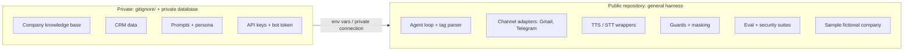
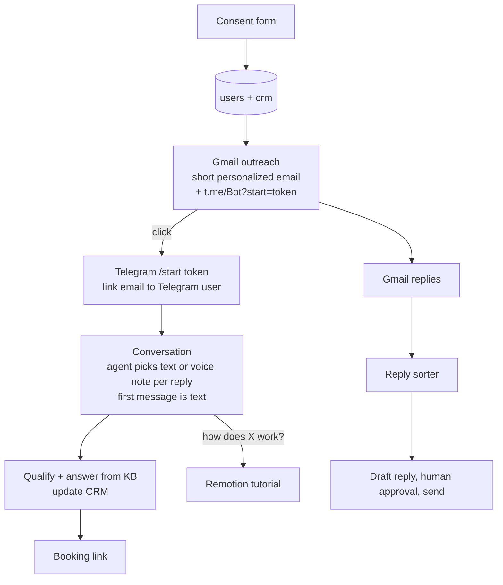
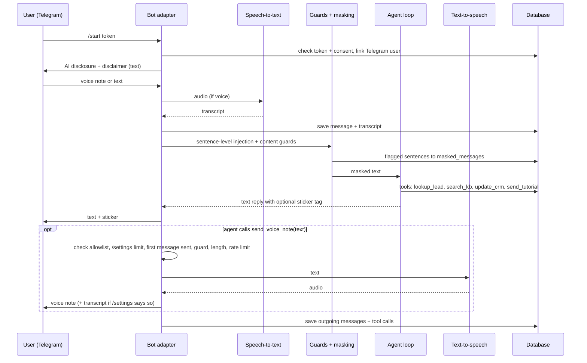

# Architecture

_Last updated: 2026-11-25_

mrktr AI is a company-agnostic GTM agent. A fixed **harness** (agent loop, tools, guards, evals) runs against a swappable **company profile**. External services sit behind interfaces, so providers can change without touching the harness.

## Public / private split



`ACTIVE_COMPANY` selects the profile in `gitignore/data/<company>/`. Nothing from `gitignore/`, `.env` or real-company data is ever committed.

## Layout

```
app/
├── backend/
│   ├── core/          settings, logging, provider registry, allowlists, errors
│   ├── data/
│   │   ├── models/        pydantic + table models
│   │   └── repositories/  database access, RLS-aware queries, analytics SQL
│   ├── endpoints/v1/  FastAPI routes for the dashboard (funnel, leads, evals, logs, mock data)
│   ├── harness/
│   │   ├── agents/        engager (first-touch email), seller (Telegram turn)
│   │   ├── tools/         tool definitions (messages, stickers, voice notes, tutorials, ...)
│   │   ├── parsers/       <e:...> tag parser
│   │   ├── prompts/       prompt assembly
│   │   ├── RAG/           index pipeline and hybrid search (Milvus Lite + fastembed)
│   │   └── evals/         performance and security eval suites
│   └── services/      one adapter per external provider
├── streamlit/         local dashboard: app.py, views/ (one file per page), orb 3D component
└── tests/             unit tests: tools, tag parser, masking, allowlists
```

Modules import from `core/` and from `services/` interfaces, never from a concrete adapter outside `services/`.

## The funnel



## Conversation flow



## Who decides what gets sent

The agent chooses the medium of every reply: text, or a voice note (through `send_voice_note`), plus at most one sticker. The user decides only by asking for a medium in the chat ("send me a voice note", "text please"); the agent then sticks to it until asked otherwise. The first message of a conversation is always text, enforced in code. `/settings` lets the user set a hard limit (`pref_mode`): *Text only* blocks voice notes in code; *Audio + transcript* / *Audio only* say whether a transcript follows each voice note. No limit set (null) means the agent decides.

| `/settings` limit (`pref_mode`) | Agent may send | `send_voice_note` |
|---|---|---|
| None (default) | Text, stickers, voice notes; the agent chooses, or follows a medium the user asked for | Allowed after the first text; no transcript |
| Audio + transcript | Text, stickers, voice notes | Allowed after the first text; transcript sent with each voice note |
| Audio only | Text, stickers, voice notes | Allowed after the first text; no transcript |
| Text only | Text, stickers | Refused by code; the agent is told and replies in text |

A medium the user asks for in the chat is followed through the prompt, not enforced in code; `/settings` *Text only* is the enforced way to block audio.

**Stickers** are `<e:name>` tags, at most one per text reply. The parser buffers until the tag closes, validates the name against the sticker list (unknown means no sticker), strips the tag and sends the sticker. Tags never trigger audio.

**Voice notes** go only through `send_voice_note(text)`, which checks in this order: allowlist and consent, the `/settings` limit, first message already sent as text, content guard, maximum length (about 60 s of speech), rate limit, then TTS, conversion to the channel's format, send and log. Refusals are logged too. No other path leads from model output to TTS.

## Masking

1. Split incoming text into sentences and score each with the injection guard and the content guard.
2. Replace flagged sentences with `[removed: possible prompt injection]` before the LLM sees them.
3. Store the originals only in `masked_messages`.
4. Answer the rest of the message normally, without accusing the user.

Benign decoys contain nothing that looks malicious, so guards will not flag them. They are logged and compared through the eval suite.

## Providers

| Capability | Interface | Adapters | Settings |
|---|---|---|---|
| LLM (chat + tools, streaming) | OpenAI-compatible client | OpenRouter, Venice AI | `LLM_PROVIDER`, `LLM_BASE_URL`, `LLM_API_KEY`, `LLM_MODEL` |
| Content safety | `ContentGuard` | Llama Guard via an OpenAI-compatible provider | `GUARD_PROVIDER`, `GUARD_MODEL`, `GUARD_API_KEY` |
| Injection detection | `InjectionGuard` | Prompt Guard (local, Hugging Face) | `INJECTION_GUARD_MODEL` |
| Text-to-speech | `TTSProvider` | ElevenLabs | `TTS_PROVIDER`, `TTS_API_KEY`, `TTS_VOICE_ID` |
| Speech-to-text | `STTProvider` | ElevenLabs | `STT_PROVIDER`, `STT_API_KEY` |
| Tutorial videos | `TutorialRenderer` | Remotion render endpoint | `REMOTION_ENDPOINT`, `REMOTION_API_KEY` |
| Embeddings + RAG | `harness/RAG/` | fastembed (local dense + BM25) in Milvus Lite (local file) | `RAG_DATA_DIR`, `RAG_DENSE_MODEL`, `RAG_SPARSE_MODEL` |
| Email | `EmailChannel` | Gmail API | `GMAIL_CREDENTIALS_PATH`, `GMAIL_SENDER` |
| Chat | `ChatChannel` | Telegram Bot API | `TELEGRAM_BOT_TOKEN` |
| Evals | `EvalBackend` | Braintrust | `BRAINTRUST_API_KEY` |
| Database | repositories | Supabase (Postgres + pgvector) | `SUPABASE_URL`, `SUPABASE_KEY`, `DATABASE_URL` |

Capabilities are checked at startup, and a missing one fails with a clear message. A provider's quirks stay inside its adapter. See [`docs/CHANNELS.md`](docs/CHANNELS.md) for the channel adapters.

## Data model

The tables, their relationships and the access rules are documented in [`SCHEMA.md`](SCHEMA.md); [`SCHEMA.sql`](SCHEMA.sql) creates them in Supabase. In short:

- **Funnel and conversation:** `users`, `crm`, `messages`, `masked_messages`, `tool_calls`, `events`, `email_drafts` (approval queue). Retrieval uses the local Milvus Lite index, not `kb_chunks`.
- **Evals, shaped like Braintrust:** `eval_datasets`, `eval_dataset_records`, `eval_experiments`, `eval_results` (one row per span, scores between 0 and 1).
- Every message has a transcript, whatever its source: `user_text`, `stt`, `agent_text` or `tts_script`.
- Row-level security is on everywhere with no policies; only the backend's service role can read or write. `masked_messages` holds raw attack text and is never exposed elsewhere.
- Deleting a user cascades to everything linked to them.
- Analytics are hand-written SQL in `data/repositories/`, one query per metric.

## Dashboard

`main.py` starts the FastAPI app (uvicorn) and the Streamlit dashboard, both bound to `127.0.0.1`. The dashboard never reads data itself: it calls the API through one small client (`app/streamlit/client.py`). Pages: Overview (3D orb and funnel), Leads, Conversations, Safety, Approvals, Evals, Logs, Data.

Until a database is connected, the API serves **mock data** from `gitignore/temp/mock/` (fictional, generated by `app/backend/data/mock.py`). Every response carries a `source` (`mock` or `empty`) and the dashboard shows a MOCK DATA banner whenever it is mock. The Data page loads or deletes it; deleting removes only the files the generator wrote.

The orb is a single self-contained component (`app/streamlit/components/orb.html` plus the vendored `three.min.js`), inlined into the page by `orb.py` so it needs no network.

## Evals and metrics

Eval suites live in `app/backend/harness/evals/` and run against Braintrust. Performance suites cover qualification, CRM writes, KB answers, STT, reply sorting, tag validity, sticker and voice-note decisions, latency and cost. Security suites cover masking, injection and decoy hijack rates, unsafe content, PII leaks, blocked recipient redirects, and replies to non-allowlisted users (must be 0).

Funnel metrics shown in the dashboard: email click-through, voice vs text replies, reply rate, turns per conversation, qualified rate, bookings, cost per qualified lead, time from email to first reply, reply-sorting accuracy, and the share of drafts approved unchanged.
