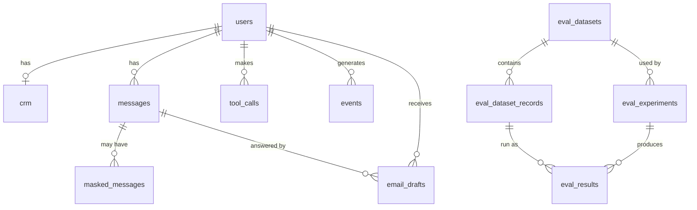

# Database schema

_Last updated: 2026-11-20_

The database is Supabase (Postgres + pgvector). [`SCHEMA.sql`](SCHEMA.sql) creates everything and is safe to run more than once.

## Set up

1. Create a **dev** Supabase project. Never point development at a production database.
2. Open **SQL Editor**, paste the contents of `SCHEMA.sql` and run it. The `vector` extension is enabled by the script.
3. Put the project values in `.env` (see `example.env`): `SUPABASE_URL`, `SUPABASE_KEY` (service-role key, backend only) and `DATABASE_URL`.
4. Check the embedding size. `kb_chunks.embedding` is `vector(1536)`. Change it in `SCHEMA.sql` before the first run if your embedding model uses another size.

## Access model

- Row-level security is **on for every table** and there are **no policies**. The `anon` and `authenticated` roles have their privileges revoked and see nothing.
- The backend uses the **service-role key**, which bypasses RLS. Never ship that key to a browser or commit it.
- `masked_messages` holds raw attack text. It is reachable only through the service role, and raw text is never written anywhere else.
- Deleting a row in `users` deletes everything linked to that user (`on delete cascade`): CRM, messages, masked messages, tool calls, events and email drafts.

## Tables

### Funnel and conversation

| Table | Purpose | Notes |
|---|---|---|
| `users` | One row per person in the funnel | `start_token` is unique; `consent_at` null means the bot must not reply; `pref_mode` is `audio_transcript`, `audio_only` or `text_only` |
| `crm` | Qualification fields written by `update_crm` | One row per user; `company_description` is a short description of what the lead's company does; `status` is `new`, `contacted`, `engaged`, `qualified`, `booked`, `not_now` or `unsubscribed` |
| `messages` | Every message in both directions | `transcript_source` is `user_text`, `stt`, `agent_text` or `tts_script`; unique per `(channel, channel_message_id)` |
| `masked_messages` | Originals of sentences removed before the LLM saw them | Service role only |
| `tool_calls` | Every tool call, refusals included | `refused_reason` is set when code refused the call |
| `events` | Funnel milestones (`email_sent`, `token_redeemed`, `mode_chosen`, `qualified`, `booked`, ...) | The source for growth metrics |
| `email_drafts` | Approval queue for replies to incoming email | **Not in the original data model**: added for the dashboard's approval page and the "% approved unchanged" metric. `final_text` equal to `draft_text` means approved unchanged |
| `kb_chunks` | Knowledge-base chunks with embeddings | `collected_at` keeps the source date |

### Evals (shaped like Braintrust)

A Braintrust trace is a tree of spans. An experiment row carries `input`, `output`, `expected`, `scores` (each 0 to 1), `metadata`, `tags`, `metrics`, span attributes and the ids that place it in the trace. A dataset record carries `input`, `expected`, `metadata` and `tags`. The tables keep the same field names so runs can be sent to Braintrust, or compared with it, without renaming.

| Table | Braintrust concept | Notes |
|---|---|---|
| `eval_datasets` | Dataset | Named set of cases |
| `eval_dataset_records` | Dataset record | `input`, `expected`, `metadata`, `tags` |
| `eval_experiments` | Experiment | `suite` is `performance` or `security`; `version` labels runs for comparison (v1, v2, before or after guards); `braintrust_experiment_id` links to the hosted run |
| `eval_results` | Experiment row / span | One row per span. `span_id`, `root_span_id` and `span_parents` rebuild the trace; `span_type` is `eval`, `task`, `llm`, `function`, `tool`, `score` or `classifier` |

| Braintrust field | Column in `eval_results` |
|---|---|
| `input`, `output`, `expected`, `error` | same names |
| `scores` | `scores` (jsonb, every value between 0 and 1 or null, enforced by `eval_scores_valid`) |
| `metadata`, `tags` | `metadata` (jsonb), `tags` (text[]) |
| `metrics` | `metrics` (jsonb of numbers: start, end, tokens, cost, latency) |
| `span_attributes.type`, `span_attributes.name` | `span_type`, `span_name` |
| `span_id`, `root_span_id`, `span_parents` | same names |

## Conventions

- Primary keys are `uuid` with `gen_random_uuid()`. Timestamps are `timestamptz` and default to `now()`.
- Allowed values are enforced with `check` constraints, not Postgres enums, so adding a value is one `alter table`.
- Every table and column carries a `comment`, visible in the Supabase table editor.
- Analytics are hand-written SQL in `app/backend/data/repositories/`, one query per metric with a comment on what it measures. They are not part of this schema file.
- The dashboard can run on local mock data before this schema is applied. See the Data page in the dashboard.

## Changing the schema

Edit `SCHEMA.sql` so it stays idempotent (`if not exists`, `create or replace`). For changes to existing tables that the script cannot express, add a separate dated migration under `docs/` and note it in `CHANGELOG.md`. Security-relevant changes (RLS, retention) also go in `SECURITY.md`.
